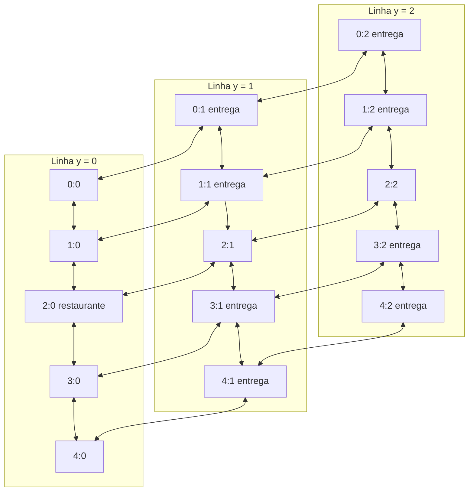
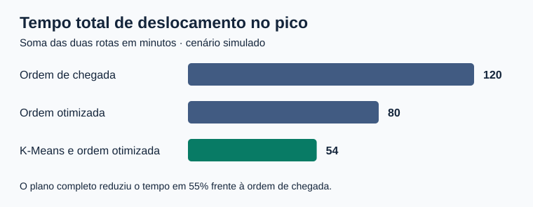

# Rota Inteligente para a Sabor Express

O projeto sugere rotas para dois entregadores que saem do restaurante, atendem a um lote de pedidos e retornam ao ponto de partida. O objetivo é minimizar o tempo de deslocamento, levando em conta ruas de mão única e a diferença entre tráfego normal e de pico. A distância percorrida e o tempo até o retorno do último entregador também são medidos.

## Execução

Requer Python 3.10 ou superior. O código usa apenas a biblioteca padrão. Na raiz do repositório, execute:

```bash
python src/rotas.py
```

O programa lê `data/ruas.csv` e `data/entregas.csv`, imprime o comparativo e gera `outputs/metricas.csv`, `outputs/rotas.csv` e `outputs/buscas.csv`. Abra os CSVs em um editor ou em uma planilha usando vírgula como separador.

## Modelo do mapa

O grafo direcionado simula 15 cruzamentos numa grade. Cada arco representa uma rua transitável no sentido informado, com 0,4 km e dois pesos em minutos. O ponto `2:0` é o restaurante. Os oito pontos de entrega estão nas colunas externas. A ligação entre `1:1` e `2:1` só permite deslocamento de `1:1` para `2:1`. O custo cresce no pico, sobretudo nas ruas ligadas à coluna central.



## Como o algoritmo decide

1. **Agrupamento.** O K-Means implementa o método de Lloyd. Para dois entregadores, começa com o menor ponto em ordem lexicográfica e o ponto mais distante dele. Alterna a atribuição ao centroide mais próximo e o cálculo da média de cada grupo até estabilizar ou atingir o limite de 100 iterações. As coordenadas agrupam regiões próximas. Os tempos da malha entram na etapa seguinte.
2. **Caminho entre duas paradas.** O A* usa uma fila de prioridade ordenada por custo acumulado mais estimativa de custo restante. A estimativa é a distância de Manhattan multiplicada pelo menor peso do período. Neste mapa, cada rua conecta vizinhos ortogonais e custa pelo menos esse peso. Logo, a estimativa é um limite inferior inclusive quando o sentido das ruas exige desvios. O cache reaproveita consultas entre pares de pontos. Com estimativa zero, a busca equivale a Dijkstra e serve de referência.
3. **Ordem de visita.** Para grupos de até sete pedidos, o programa avalia todas as permutações e escolhe a de menor tempo total, incluindo o retorno. Em caso de empate, compara a distância dos trajetos encontrados pelo A*. Acima de sete, visita sempre a parada restante com menor tempo estimado a partir da posição atual. A busca por permutações é exata para os grupos fixados e tem custo fatorial. O vizinho mais próximo reduz esse custo e pode produzir uma ordem subótima. O K-Means não garante o melhor agrupamento global.

## Experimento e resultados

Todos os cenários usam os mesmos pedidos, grafo, dois entregadores e trajetos de menor tempo entre as paradas. A linha de base divide a fila em dois lotes consecutivos e mantém a ordem de chegada. O segundo cenário mantém esses lotes e otimiza a ordem. O terceiro aplica K-Means antes de otimizar. A linha de base é simulada e usa A* entre paradas para isolar o efeito da ordem e do agrupamento.

| Tráfego | Estratégia | Minutos somados | Último retorno (min) | Distância total (km) |
| --- | --- | ---: | ---: | ---: |
| Normal | Ordem de chegada | 56 | 32 | 12,8 |
| Normal | Ordem otimizada | 40 | 22 | 9,6 |
| Normal | K-Means e ordem otimizada | 30 | 18 | 6,4 |
| Pico | Ordem de chegada | 120 | 64 | 12,8 |
| Pico | Ordem otimizada | 80 | 42 | 9,6 |
| Pico | K-Means e ordem otimizada | 54 | 30 | 6,4 |

No pico, otimizar apenas a ordem reduziu o tempo somado de 120 para 80 minutos (33,3%). O agrupamento reduziu esse resultado em mais 26 minutos. Em relação à linha de base, o plano completo reduziu o tempo somado em 55%, encurtou o último retorno de 64 para 30 minutos e cortou a distância pela metade. Os minutos somados representam o esforço das duas rotas. O último retorno considera que ambos os entregadores saem juntos.

O A* e o Dijkstra encontraram os mesmos custos mínimos nos 72 pares direcionados testados em cada período. O A* expandiu 464 nós contra 622 no cenário normal e 448 contra 617 no pico. Essas contagens incluem o destino e somam as expansões de todas as buscas. Elas indicam menos exploração neste mapa. O experimento não mediu tempo de CPU.

## Limitações e melhorias

O estudo simula um único lote com pesos fixos por período. Não inclui tempo de serviço, capacidade do veículo, prazos individuais, novos pedidos durante a rota ou custo monetário de combustível. K-Means usa proximidade geométrica, que pode não refletir barreiras, vias de mão única ou congestionamento, e pode formar grupos de tamanhos diferentes. Os resultados devem ser validados com pedidos históricos, tempos reais e múltiplos lotes antes de estimar impacto comercial.

Uma próxima versão pode usar tempos observados por rua, planejar com janelas de entrega e capacidade, e medir atraso por pedido. Para lotes maiores, uma melhoria local como 2-opt pode refinar a ordem inicial, recalculando os arcos afetados porque os custos são direcionados.

## Referências

- [K-Means e o método de Lloyd, documentação do scikit-learn](https://scikit-learn.org/stable/modules/generated/sklearn.cluster.KMeans.html)
- [Entrevista com Jack Levis, da UPS, sobre o sistema ORION](https://www.esri.com/about/newsroom/publications/wherenext/buzzwords-hidden-dimensions-and-innovation-a-ups-story)

O roteiro de gravação está em [docs/roteiro-pitch.md](docs/roteiro-pitch.md).



